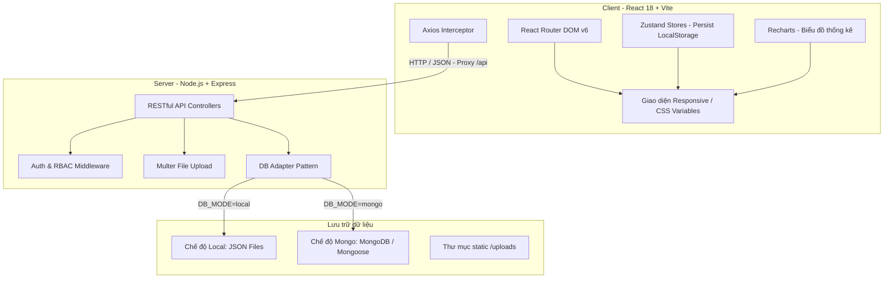
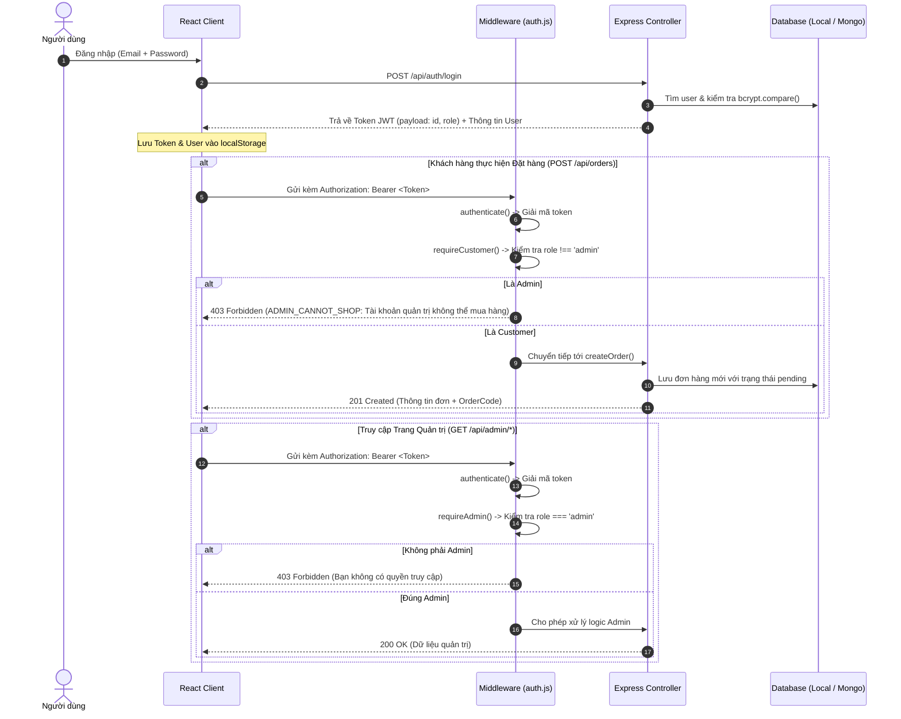
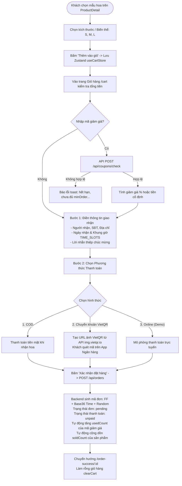
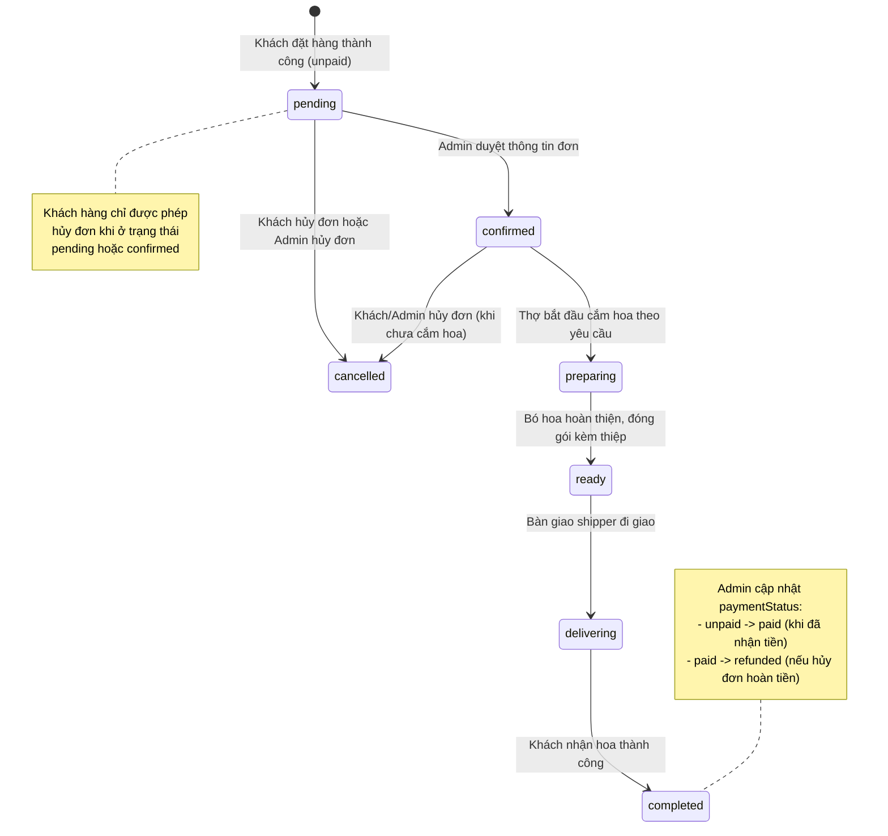
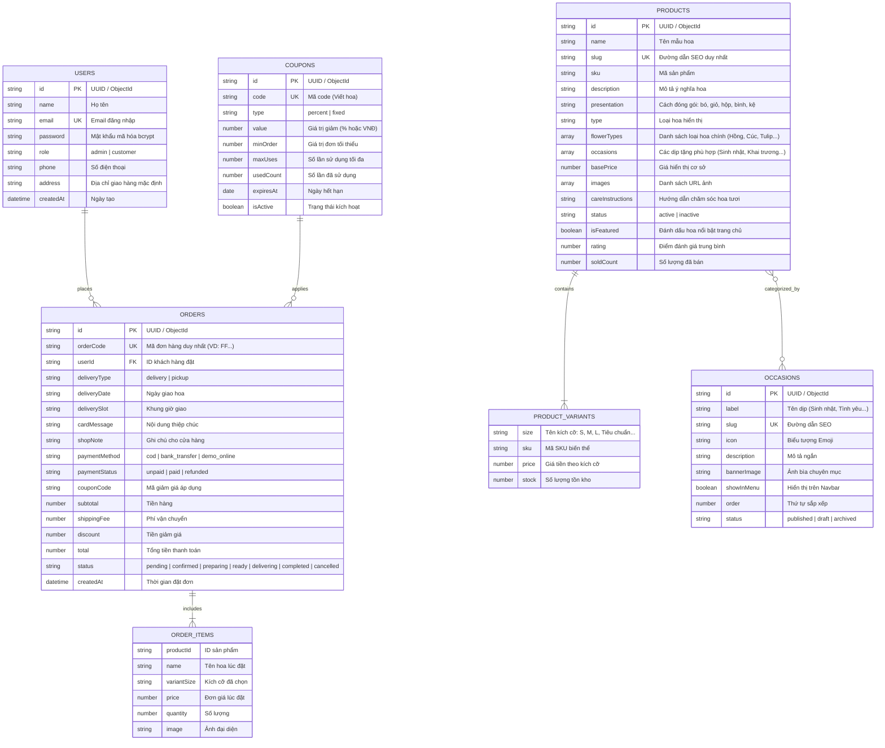

# 🌸 FLORA FLOWER - HỆ THỐNG THƯƠNG MẠI ĐIỆN TỬ HOA TƯƠI CAO CẤP

> **Tài liệu đặc tả kiến trúc, hướng dẫn triển khai và cẩm nang bảo vệ đồ án tốt nghiệp / đồ án môn học.**  
> *Phiên bản tài liệu: 2.0 (Phân tích đối chiếu toàn diện từ mã nguồn thực tế).*

---

## 📑 MỤC LỤC
1. [A. Tổng quan dự án](#a-tổng-quan-dự-án)
2. [B. Công nghệ và Thư viện sử dụng](#b-công-nghệ-và-thư-viện-sử-dụng)
3. [C. Cấu trúc thư mục và File quan trọng](#c-cấu-trúc-thư-mục-và-file-quan-trọng)
4. [D. Bảng chức năng thực tế theo vai trò](#d-bảng-chức-năng-thực-tế-theo-vai-trò)
5. [E. Kiến trúc hệ thống và Luồng xử lý (Mermaid)](#e-kiến-trúc-hệ-thống-và-luồng-xử-lý-mermaid)
6. [F. Thiết kế Cơ sở dữ liệu và Cơ chế Lưu trữ kép (Adapter)](#f-thiết-kế-cơ-sở-dữ-liệu-và-cơ-chế-lưu-trữ-kép-adapter)
7. [G. Hướng dẫn cài đặt, cấu hình và vận hành](#g-hướng-dẫn-cài-đặt-cấu-hình-và-vận-hành)
8. [H. Đánh giá hiện trạng: Kết quả, Lỗi tồn đọng và Hướng phát triển](#h-đánh-giá-hiện-trạng-kết-quả-lỗi-tồn-đọng-và-hướng-phát-triển)
9. [I. Cẩm nang thuyết trình và Bảo vệ đồ án](#i-cẩm-nang-thuyết-trình-và-bảo-vệ-đồ-án)

---

## A. TỔNG QUAN DỰ ÁN

### 1. Giới thiệu dự án
- **Tên dự án:** FLORA FLOWER (Website Thương Mại Điện Tử Hoa Tươi Chuyên Nghiệp).
- **Lĩnh vực:** E-Commerce ngành hàng hoa tươi nghệ thuật, quà tặng và sự kiện.
- **Mục tiêu:** Cung cấp giải pháp mua sắm hoa tươi trực tuyến toàn diện, giải quyết các nhu cầu đặc thù của khách hàng khi đặt mua hoa (chọn kích thước/biến thể, cá nhân hóa lời nhắn thiệp chúc mừng, hẹn giờ giao hàng chính xác, thanh toán linh hoạt qua mã VietQR và tra cứu hành trình đơn hàng không cần đăng nhập).

### 2. Bài toán và Phạm vi giải quyết
| Yếu tố | Đặc thù ngành hoa tươi | Giải pháp trong Flora Flower |
| :--- | :--- | :--- |
| **Biến thể sản phẩm** | Mỗi mẫu hoa có kích thước, số lượng cành và cách phối khác nhau | Hỗ trợ quản lý Variants động (Size S, M, L, Tiêu chuẩn, Đặc biệt) với giá tiền và số lượng kho riêng biệt |
| **Tính thời điểm** | Hoa tươi cần giao đúng ngày, đúng khung giờ kỷ niệm/sinh nhật | Tích hợp chọn ngày giao (`deliveryDate`) và khung giờ nhận hoa (`TIME_SLOTS`) chi tiết |
| **Cá nhân hóa** | Đơn hoa thường đi kèm thiệp chúc mừng hoặc thông điệp gửi gắm | Hỗ trợ nhập nội dung thiệp chúc (`cardMessage`) và ghi chú đặc biệt cho thợ cắm hoa (`shopNote`) |
| **Thanh toán nhanh** | Xu hướng chuyển khoản nhanh qua ứng dụng ngân hàng tại Việt Nam | Tích hợp hiển thị mã VietQR động theo chuẩn ngân hàng, kèm sao chép thông tin chuyển khoản 1 chạm |
| **Tra cứu tiện lợi** | Người nhận hoa hoặc người gửi cần theo dõi trạng thái đơn hàng | Cung cấp cổng tra cứu công khai (`TrackOrder`) chỉ bằng Mã đơn và Số điện thoại |

### 3. Đối tượng sử dụng
- **Khách vãng lai (Guest):** Người truy cập tìm kiếm mẫu hoa theo dịp, xem chi tiết, lưu danh sách yêu thích (Wishlist) hoặc xem lại các mẫu đã xem trên trình duyệt, tra cứu trạng thái đơn hàng.
- **Khách hàng thành viên (Customer):** Tài khoản đã đăng ký/đăng nhập, quản lý giỏ hàng, áp dụng mã giảm giá, đặt đơn hàng, xem lịch sử và quản lý tiến trình các đơn hàng cá nhân, chủ động hủy đơn khi đơn chưa xử lý.
- **Quản trị viên (Admin):** Chủ cửa hàng/nhân viên vận hành quản lý doanh thu qua biểu đồ, quản trị vòng đời đơn hàng, quản lý kho sản phẩm và biến thể, cấu hình danh mục dịp lễ, tạo mã coupon khuyến mãi, xem hồ sơ chi tiêu khách hàng và cấu hình thông tin cửa hàng / tài khoản ngân hàng.

---

## B. CÔNG NGHỆ VÀ THƯ VIỆN SỬ DỤNG

### 1. Phân tầng công nghệ (Tech Stack)



### 2. Chi tiết các công nghệ và thư viện cốt lõi

#### Frontend (Thư mục `client/`)
- **React 18.3.1 & Vite 5.4.0:** Nền tảng xây dựng Single Page Application (SPA) với tốc độ render cao và Hot Module Replacement (HMR).
- **React Router DOM v6.26.0:** Định tuyến trang, phân tách rõ ràng khu vực Client (`/`, `/shop`, `/product/:slug`, `/cart`, `/checkout`, `/orders...`) và Admin (`/admin`, `/admin/orders`, `/admin/products...`).
- **Zustand 4.5.0 + `persist` middleware:** Quản lý state toàn cục gọn nhẹ, tự động đồng bộ xuống `localStorage`:
  - `useAuthStore`: Quản lý phiên đăng nhập (User, Token, Role).
  - `useCartStore`: Quản lý giỏ hàng, số lượng, tính tổng tiền.
  - `useWishlistStore`: Quản lý danh sách hoa yêu thích của người dùng.
  - `useRecentStore`: Lưu trữ tối đa 12 sản phẩm vừa xem gần nhất.
  - `useToastStore`: Hệ thống thông báo toast tự động biến mất (Success, Error, Info).
- **Recharts 2.12.0:** Thư viện biểu đồ phục vụ trực quan hóa dữ liệu thống kê trên Admin Dashboard (doanh thu theo ngày, biểu đồ tròn trạng thái đơn, top sản phẩm bán chạy).
- **Lucide React 0.441.0:** Bộ icon đồng bộ, chuẩn hiện đại.
- **React Hook Form 7.53.0:** Tối ưu hóa xử lý form đặt hàng, form thêm/sửa sản phẩm và quản lý validate.
- **Axios 1.7.0:** HTTP Client tích hợp `interceptors` tự động đính kèm `Bearer JWT Token` vào header mỗi request và tự động chuyển hướng khi gặp mã lỗi 401.
- **Styling:** Vanilla CSS nâng cao dựa trên Design Tokens (`index.css` ~ 50KB), khai báo hệ biến màu CSS, Typography Serif kết hợp Sans-serif chuẩn phong cách thương hiệu cao cấp, hỗ trợ hiệu ứng Glassmorphism và Mobile Sticky Action Bar.

#### Backend (Thư mục `server/`)
- **Node.js & Express 4.19.2:** Khung ứng dụng RESTful API backend, tổ chức theo mô hình Route - Middleware - Controller - Service/DB.
- **JSON Web Token (jsonwebtoken 9.0.2) & bcrypt 5.1.1:** Xác thực người dùng không trạng thái (Stateless Authentication), mã hóa băm mật khẩu 10 vòng muối (salt rounds).
- **Multer 1.4.5-lts.1:** Middleware xử lý tải lên tệp tin hình ảnh sản phẩm, kiểm tra định dạng (.jpg, .png, .webp, .gif) và lưu trữ cục bộ vào `server/uploads/products/`.
- **Mongoose 8.3.4:** ODM làm việc với MongoDB khi chạy ở chế độ cơ sở dữ liệu phân tán.
- **UUID 9.0.1:** Sinh định danh duy nhất chuẩn RFC4122 cho các bản ghi khi chạy ở chế độ file JSON nội bộ.
- **CORS & Dotenv:** Cấu hình mở chia sẻ tài nguyên chéo nguồn và quản lý biến môi trường.

---

## C. CẤU TRÚC THƯ MỤC VÀ FILE QUAN TRỌNG

```
d:/shophoa/
├── README.md                      # [File này] Tài liệu tổng quan & thuyết trình đồ án
├── client/                        # Mã nguồn ứng dụng Frontend (React + Vite)
│   ├── index.html                 # Template HTML gốc
│   ├── package.json               # Khai báo thư viện & scripts Frontend
│   ├── vite.config.js             # Cấu hình Vite & Proxy chuyển tiếp /api sang port 5000
│   └── src/
│       ├── main.jsx               # Điểm khởi đầu React, thiết lập định tuyến Routes
│       ├── App.jsx                # Layout chung người dùng (Header + Outlet + Footer + Toast)
│       ├── index.css              # Hệ thống CSS Design System toàn bộ dự án
│       ├── components/
│       │   ├── layout/
│       │   │   ├── Header.jsx     # Thanh điều hướng, tìm kiếm, giỏ hàng, menu tài khoản
│       │   │   ├── Footer.jsx     # Chân trang thông tin, liên hệ, chính sách
│       │   │   └── AdminLayout.jsx# Khung giao diện quản trị với Sidebar điều hướng
│       │   └── ui/
│       │       ├── ProductCard.jsx# Thẻ sản phẩm dùng chung (ảnh, giá, badge, nút mua/thích)
│       │       └── ToastContainer.jsx # Khung hiển thị thông báo góc màn hình
│       ├── pages/
│       │   ├── Home.jsx           # Trang chủ (Hero, Banner, Danh mục, Hoa nổi bật, Cam kết)
│       │   ├── Shop.jsx           # Trang danh mục (Bộ lọc đa năng, Tìm kiếm, Sắp xếp, Phân trang)
│       │   ├── ProductDetail.jsx  # Chi tiết mẫu hoa (Chọn size, đổi giá, thành phần, hoa tương tự)
│       │   ├── OccasionPage.jsx   # Trang chuyên đề theo từng Dịp tặng hoa
│       │   ├── Cart.jsx           # Giỏ hàng chi tiết, tăng giảm số lượng, nhập mã giảm giá
│       │   ├── Checkout.jsx       # Thanh toán 2 bước (Địa chỉ/giờ giao + Chọn COD/VietQR)
│       │   ├── OrderSuccess.jsx   # Thông báo đặt hàng thành công + Hướng dẫn thanh toán
│       │   ├── Orders.jsx         # Danh sách đơn hàng đã mua của thành viên
│       │   ├── OrderDetail.jsx    # Chi tiết đơn hàng thành viên (Có nút hủy đơn)
│       │   ├── TrackOrder.jsx     # Tra cứu công khai hành trình đơn không cần đăng nhập
│       │   ├── Wishlist.jsx       # Danh sách các mẫu hoa khách đã bấm yêu thích
│       │   ├── Profile.jsx        # Xem và cập nhật thông tin cá nhân (Tên, SĐT, Địa chỉ)
│       │   ├── Login.jsx          # Đăng nhập hệ thống (Phân luồng khách / admin)
│       │   ├── Register.jsx       # Đăng ký tài khoản khách hàng mới
│       │   └── admin/
│       │       ├── AdminDashboard.jsx    # Bảng điều khiển thống kê doanh thu, đơn hàng, biểu đồ
│       │       ├── AdminOrders.jsx       # Quản lý danh sách đơn, cập nhật trạng thái đơn/tiền
│       │       ├── AdminProducts.jsx     # Quản lý sản phẩm (CRUD, biến thể size/kho, upload ảnh)
│       │       ├── AdminCustomers.jsx    # Danh sách khách hàng kèm số đơn đã đặt
│       │       ├── AdminCustomerDetail.jsx # Hồ sơ chi tiết khách hàng & lịch sử mua sắm
│       │       ├── AdminCoupons.jsx      # Quản lý danh sách & tạo mới mã giảm giá
│       │       ├── AdminOccasions.jsx    # Quản lý các Dịp tặng hoa (Menu, banner, mô tả)
│       │       └── AdminSettings.jsx     # Cấu hình thông tin shop, phí ship, tài khoản VietQR
│       ├── services/
│       │   └── api.js             # Cấu hình Axios instance + Interceptor gắn Token
│       ├── store/
│       │   ├── useAuthStore.js    # Zustand store: user, token, login, logout, role check
│       │   ├── useCartStore.js    # Zustand store: items, addToCart, updateQuantity, totals
│       │   ├── useWishlistStore.js# Zustand store: danh sách yêu thích
│       │   ├── useRecentStore.js  # Zustand store: sản phẩm vừa xem
│       │   └── useToastStore.js   # Zustand store: thông báo nổi
│       └── utils/
│           └── helpers.js         # Hàm format tiền VND, ngày tháng VN, nhãn trạng thái
└── server/                        # Mã nguồn ứng dụng Backend (Node.js + Express)
    ├── package.json               # Khai báo thư viện & scripts Backend
    ├── .env                       # File cấu hình biến môi trường cục bộ
    ├── .env.example               # Mẫu cấu hình môi trường chuẩn
    ├── data/                      # Thư mục lưu dữ liệu JSON khi chạy DB_MODE=local
    │   ├── products.json          # Dữ liệu sản phẩm hoa
    │   ├── orders.json            # Dữ liệu các đơn đặt hàng
    │   ├── users.json             # Dữ liệu tài khoản người dùng
    │   ├── coupons.json           # Dữ liệu mã giảm giá
    │   ├── occasions.json         # Dữ liệu các dịp tặng hoa
    │   └── settings.json          # Cấu hình cửa hàng, vận chuyển, tài khoản VietQR
    ├── uploads/products/          # Thư mục chứa hình ảnh sản phẩm được upload qua Multer
    └── src/
        ├── index.js               # Điểm khởi chạy Express server, static files, routes
        ├── seed.js                # Kịch bản khởi tạo dữ liệu mẫu ban đầu
        ├── fix-images.js          # Script bảo trì cập nhật ảnh Unsplash (tiện ích phụ)
        ├── db/
        │   ├── index.js           # Adapter Factory điều phối giữa LocalDb và MongoDb
        │   ├── localDb.js         # Lớp triển khai CRUD trên tệp tin JSON
        │   └── mongoDb.js         # Lớp bọc triển khai CRUD trên Mongoose Models
        ├── models/
        │   ├── Product.js         # Schema Mongoose cho Sản phẩm & Biến thể (Variants)
        │   ├── Order.js           # Schema Mongoose cho Đơn hàng
        │   ├── User.js            # Schema Mongoose cho Tài khoản người dùng
        │   ├── Coupon.js          # Schema Mongoose cho Mã giảm giá
        │   └── Occasion.js        # Schema Mongoose cho Dịp tặng hoa
        ├── middlewares/
        │   ├── auth.js            # Middleware authenticate, requireAdmin, requireCustomer
        │   └── authMiddleware.js  # Middleware dự phòng/cũ
        ├── routes/
        │   ├── authRoutes.js      # Endpoint: Đăng ký, đăng nhập, hồ sơ cá nhân
        │   ├── productRoutes.js   # Endpoint: Lấy danh sách, chi tiết theo slug
        │   ├── orderRoutes.js     # Endpoint: Đặt hàng, đơn của tôi, tra cứu công khai, hủy đơn
        │   ├── couponRoutes.js    # Endpoint: Kiểm tra tính hợp lệ & tính tiền giảm giá
        │   ├── adminRoutes.js     # Endpoint: Dashboard, đơn hàng, khách hàng, sản phẩm
        │   ├── occasionRoutes.js  # Endpoint: Dịp tặng hoa (Public & Quản trị)
        │   ├── settingsRoutes.js  # Endpoint: Cài đặt shop & cấu hình VietQR
        │   └── uploadRoutes.js    # Endpoint: Tải lên hình ảnh bằng Multer
        └── controllers/
            ├── authController.js      # Xử lý logic xác thực & thông tin tài khoản
            ├── productController.js   # Xử lý tìm kiếm, lọc, phân trang sản phẩm
            ├── orderController.js     # Xử lý đặt đơn, sinh mã, kiểm tra hủy, tra cứu
            ├── couponController.js    # Xử lý kiểm tra điều kiện áp dụng mã
            ├── adminController.js     # Xử lý thống kê Dashboard và toàn bộ CRUD Admin
            ├── occasionController.js  # Xử lý nghiệp vụ dịp tặng hoa
            └── settingsController.js  # Xử lý đọc/ghi cấu hình hệ thống
```

---

## D. BẢNG CHỨC NĂNG THỰC TẾ THEO VAI TRÒ

Dưới đây là bảng phân loại chi tiết các tính năng có trong mã nguồn dự án, được phân tách minh bạch giữa các tính năng **Đã hoàn thiện**, **Tính năng mô phỏng/Demo**, và **Tính năng chưa hoàn thiện**:

### 1. Phân loại tính năng chi tiết

| Vai trò | Nhóm chức năng | Tên tính năng | Tình trạng thực tế trong Code | File xử lý chính (Frontend / Backend) |
| :--- | :--- | :--- | :--- | :--- |
| **Khách vãng lai** | Khám phá sản phẩm | Xem danh sách & Phân trang | ✅ Hoàn thiện (Hỗ trợ phân trang 12-20 sp/trang) | `Shop.jsx` / `productController.js` |
| | | Tìm kiếm theo từ khóa | ✅ Hoàn thiện (Tìm theo tên và mô tả sản phẩm) | `Shop.jsx` / `productController.js` |
| | | Lọc đa tiêu chí | ✅ Hoàn thiện (Lọc theo Dịp, Loại hoa, Khoảng giá, Còn hàng) | `Shop.jsx` / `productController.js` |
| | | Sắp xếp sản phẩm | ✅ Hoàn thiện (Mới nhất, Bán chạy, Giá tăng/giảm dần) | `Shop.jsx` / `productController.js` |
| | Chi tiết sản phẩm | Chọn biến thể (Size/Giá) | ✅ Hoàn thiện (Đổi size thì giá tiền và tồn kho tự nhảy) | `ProductDetail.jsx` / `ProductCard.jsx` |
| | | Xem thành phần & Chăm sóc | ✅ Hoàn thiện (Hiển thị tab chi tiết, gợi ý hoa tương tự) | `ProductDetail.jsx` |
| | | Đánh giá & Bình luận (Review) | ⚠️ **Chưa hoàn thiện** (Chỉ hiển thị rating tĩnh từ DB, chưa có bảng review và chưa có form gửi đánh giá) | `ProductDetail.jsx` (dòng 383-401) |
| | Giỏ & Yêu thích | Thêm/Xóa giỏ hàng | ✅ Hoàn thiện (Quản lý qua Zustand `useCartStore`, lưu localStorage) | `Cart.jsx`, `useCartStore.js` |
| | | Danh sách yêu thích | ✅ Hoàn thiện (Lưu trữ qua `useWishlistStore`) | `Wishlist.jsx`, `useWishlistStore.js` |
| | | Danh sách vừa xem | ✅ Hoàn thiện (Tự lưu tối đa 12 sản phẩm vào `useRecentStore`) | `useRecentStore.js`, `Home.jsx` |
| | Đơn hàng | Tra cứu đơn hàng công khai | ✅ Hoàn thiện (Nhập Mã đơn + SĐT tra cứu không cần đăng nhập) | `TrackOrder.jsx` / `orderController.js` |
| **Khách hàng (Customer)** | Tài khoản | Đăng ký & Đăng nhập | ✅ Hoàn thiện (JWT, mã hóa mật khẩu bcrypt) | `Login.jsx`, `Register.jsx` / `authController.js` |
| | | Quản lý hồ sơ | ✅ Hoàn thiện (Xem và cập nhật Tên, SĐT, Địa chỉ) | `Profile.jsx` / `authController.js` |
| | Đặt hàng | Điền thông tin giao hoa | ✅ Hoàn thiện (Họ tên, SĐT, Địa chỉ hoặc nhận tại shop) | `Checkout.jsx` / `orderController.js` |
| | | Hẹn giờ nhận & Viết thiệp | ✅ Hoàn thiện (Chọn ngày + Khung giờ `TIME_SLOTS`, nội dung thiệp) | `Checkout.jsx` / `orderController.js` |
| | | Áp dụng mã giảm giá | ✅ Hoàn thiện (Kiểm tra minOrder, maxUses, hạn sử dụng, tính tiền trừ) | `Checkout.jsx` / `couponController.js` |
| | Thanh toán | Thanh toán COD | ✅ Hoàn thiện (Tiền mặt khi giao hàng) | `Checkout.jsx` / `orderController.js` |
| | | Chuyển khoản VietQR | ⚡ **Mô phỏng/Bán tự động** (Hiển thị mã QR động tạo từ `img.vietqr.io` để quét thủ công; chưa có Webhook tự đổi trạng thái) | `Checkout.jsx` / `settingsController.js` |
| | | Thanh toán Online Demo | ⚡ **Mô phỏng (Demo)** (Giao diện giả lập thanh toán online, không kết nối cổng thật) | `Checkout.jsx` |
| | Quản lý đơn | Lịch sử mua hàng cá nhân | ✅ Hoàn thiện (Xem toàn bộ danh sách đơn hàng đã mua) | `Orders.jsx`, `OrderDetail.jsx` / `orderController.js` |
| | | Hủy đơn hàng | ✅ Hoàn thiện (Chỉ cho phép hủy khi đơn ở trạng thái `pending`/`confirmed`) | `OrderDetail.jsx` / `orderController.js` |
| **Quản trị viên (Admin)** | Thống kê | Dashboard tổng quan | ✅ Hoàn thiện (Doanh thu, số lượng đơn theo 7 trạng thái, top 5 bán chạy) | `AdminDashboard.jsx` / `adminController.js` |
| | | Biểu đồ doanh thu Recharts | ✅ Hoàn thiện (Vẽ biểu đồ đường/cột doanh thu thực thu theo ngày) | `AdminDashboard.jsx` / `adminController.js` |
| | Quản lý đơn | Cập nhật trạng thái đơn | ✅ Hoàn thiện (Chuyển tiếp qua 7 trạng thái xử lý đơn hàng) | `AdminOrders.jsx` / `adminController.js` |
| | | Cập nhật thanh toán | ✅ Hoàn thiện (Đổi trạng thái: `unpaid` -> `paid` -> `refunded`) | `AdminOrders.jsx` / `adminController.js` |
| | Quản lý sản phẩm | Thêm / Sửa / Xóa sản phẩm | ✅ Hoàn thiện (CRUD đầy đủ, tự sinh slug tiếng Việt không dấu) | `AdminProducts.jsx` / `adminController.js` |
| | | Cấu hình biến thể (Variants) | ✅ Hoàn thiện (Thêm/xóa size, gán giá và số lượng kho cho từng size) | `AdminProducts.jsx` / `adminController.js` |
| | | Tải lên hình ảnh hoa | ✅ Hoàn thiện (Upload 1 ảnh hoặc tối đa 10 ảnh qua Multer) | `AdminProducts.jsx` / `uploadRoutes.js` |
| | Quản lý chuyên đề | Quản lý Dịp tặng hoa | ✅ Hoàn thiện (CRUD danh mục dịp, icon emoji, banner, slug, thứ tự hiển thị) | `AdminOccasions.jsx` / `occasionController.js` |
| | Khuyến mãi | Quản lý Mã giảm giá | ✅ Hoàn thiện (Tạo mã %, tiền cố định, giới hạn lượt dùng, đơn tối thiểu, hạn) | `AdminCoupons.jsx` / `adminController.js` |
| | Khách hàng | Quản lý khách hàng | ✅ Hoàn thiện (Danh sách khách hàng, thống kê số đơn đã mua) | `AdminCustomers.jsx` / `adminController.js` |
| | | Chi tiết hồ sơ khách hàng | ✅ Hoàn thiện (Xem toàn bộ lịch sử đơn và tổng tiền thực thu của khách) | `AdminCustomerDetail.jsx` / `adminController.js` |
| | Cấu hình | Cấu hình Cửa hàng & VietQR | ✅ Hoàn thiện (Thông tin shop, phí ship, số TK ngân hàng, xem trước QR) | `AdminSettings.jsx` / `settingsController.js` |

---

## E. KIẾN TRÚC HỆ THỐNG VÀ LUỒNG XỬ LÝ (MERMAID)

### 1. Kiến trúc phân quyền và bảo vệ tài nguyên (Authentication & RBAC)

Hệ thống triển khai cơ chế kiểm soát truy cập dựa trên vai trò (Role-Based Access Control - RBAC) tại Backend. Điểm đặc biệt trong dự án là **Admin bị cấm dùng tài khoản quản trị để đặt hoa**, đảm bảo tính toàn vẹn dữ liệu đơn hàng:



### 2. Luồng xử lý Giỏ hàng, Đặt hàng và Phương thức Thanh toán

Quy trình thanh toán trong hệ thống được thiết kế theo 2 bước rõ ràng (`Checkout.jsx`):



### 3. Quy trình Quản trị vòng đời Đơn hàng (Order Lifecycle)

Các đơn hàng sau khi tạo sẽ trải qua quy trình quản lý trạng thái khép kín trên trang Admin (`AdminOrders.jsx`):



---

## F. THIẾT KẾ CƠ SỞ DỮ LIỆU VÀ CƠ CHẾ LƯU TRỮ KÉP (ADAPTER)

### 1. Kiến trúc Database Adapter Pattern (`server/src/db/`)
Dự án giải quyết xuất sắc bài toán triển khai linh hoạt giữa môi trường học tập/thuyết trình và môi trường triển khai thực tế thông qua **Adapter Pattern**:
- Khởi tạo tại `server/src/db/index.js`, kiểm tra biến môi trường `process.env.DB_MODE`.
- Cả hai lớp `LocalDb` (`localDb.js`) và `MongoDb` (`mongoDb.js`) đều triển khai cùng một bộ phương thức chuẩn (Interface):
  - `find(query)`: Lọc dữ liệu theo đối tượng truy vấn.
  - `findById(id)`: Tìm bản ghi theo ID duy nhất.
  - `create(doc)`: Tạo bản ghi mới (sinh `id` bằng UUIDv4 ở local hoặc ObjectId ở Mongo).
  - `updateById(id, updateData)`: Cập nhật bản ghi và tự động cập nhật mốc thời gian `updatedAt`.
  - `deleteById(id)`: Xóa bản ghi theo ID.
- Lớp `MongoDb` tự động chuyển đổi `_id` thành `id` kiểu String, giúp các Controllers (`productController`, `orderController`...) hoàn toàn độc lập và không cần viết lại dù đổi hệ quản trị CSDL.

### 2. Chi tiết các Entities / Schemas



### 3. File cấu hình cửa hàng (`server/data/settings.json`)
Lưu trữ các cấu hình động không cần restart máy chủ:
- `shop`: Tên cửa hàng, hotline, email, địa chỉ, giờ mở cửa, mạng xã hội.
- `shipping`: Phí giao hàng tiêu chuẩn (mặc định 30.000đ), ngưỡng miễn phí vận chuyển (mặc định 500.000đ).
- `bank`: Cấu hình tài khoản VietQR gồm: mã ngân hàng (`bankCode`: VCB, TCB, MB...), số tài khoản (`accountNumber`), tên chủ tài khoản (`accountName`), cú pháp chuyển khoản (`transferNote`: `FLORA {ORDER_ID}`).

---

## G. HƯỚNG DẪN CÀI ĐẶT, CẤU HÌNH VÀ VẬN HÀNH

> ⚠️ **LƯU Ý:** Các bước dưới đây được xây dựng dựa trên việc phân tích cấu hình thực tế trong `package.json` và `.env.example`. Các lệnh này chưa được thực thi tự động nhằm tuân thủ nguyên tắc không làm biến đổi môi trường và dữ liệu của bạn.

### 1. Yêu cầu môi trường
- **Node.js:** Phiên bản `>= 18.x` (Khuyến nghị bản LTS 18 hoặc 20).
- **Trình quản lý gói:** `npm` (đi kèm Node.js).
- **Trình duyệt:** Chrome, Edge, Firefox phiên bản hiện đại hỗ trợ ES Modules.

### 2. Các bước thiết lập Backend (`server/`)

1. Mở cửa sổ dòng lệnh (Terminal 1) và di chuyển vào thư mục backend:
   ```bash
   cd server
   ```

2. Cài đặt các gói phụ thuộc (Dependencies):
   ```bash
   npm install
   ```

3. Cấu hình biến môi trường:
   - Đảm bảo trong thư mục `server/` có file `.env`. Nếu chưa có, sao chép từ `.env.example`:
     ```env
     PORT=5000
     DB_MODE=local
     MONGODB_URI=mongodb://localhost:27017/shophoa
     JWT_SECRET=supersecretfloraflower2024
     ```
   - **Giải thích biến cấu hình:**
     - `PORT`: Cổng lắng nghe của máy chủ Express (Mặc định `5000`).
     - `DB_MODE`: Chọn `local` để chạy bằng file JSON trong thư mục `data/` (không cần cài thêm database). Chọn `mongo` nếu muốn kết nối MongoDB.
     - `MONGODB_URI`: Chuỗi kết nối MongoDB (chỉ cần khi `DB_MODE=mongo`).
     - `JWT_SECRET`: Chuỗi khóa bí mật dùng để ký và xác thực mã JWT Token.

4. Tạo dữ liệu mẫu khởi tạo (Seed Data - *Tùy chọn nếu file JSON đã có sẵn dữ liệu*):
   ```bash
   node src/seed.js
   ```
   > File seed sẽ tự động tạo các sản phẩm mẫu, danh mục các Dịp tặng hoa, mã giảm giá và 2 tài khoản mặc định:
   > - **Admin:** `admin@floraflower.vn` / Mật khẩu: `admin123`
   > - **Khách hàng:** `customer@example.com` / Mật khẩu: `customer123`

5. Khởi động máy chủ Backend:
   ```bash
   # Chế độ phát triển (Tự reload khi sửa code qua nodemon)
   npm run dev
   
   # Hoặc chế độ chạy thường
   npm start
   ```
   *Khi khởi động thành công, màn hình sẽ hiển thị: `🌸 Flora Flower Server running on port 5000 [local mode]`.*

### 3. Các bước thiết lập Frontend (`client/`)

1. Mở cửa sổ dòng lệnh thứ hai (Terminal 2) và di chuyển vào thư mục frontend:
   ```bash
   cd client
   ```

2. Cài đặt các gói phụ thuộc:
   ```bash
   npm install
   ```

3. Khởi động máy chủ phát triển Vite:
   ```bash
   npm run dev
   ```

4. Truy cập ứng dụng:
   - Mở trình duyệt và truy cập địa chỉ do Vite cung cấp (thường là `http://localhost:5173`).
   - Mọi request có tiền tố `/api` và `/uploads` sẽ được Vite tự động chuyển tiếp (Proxy) sang `http://localhost:5000` của Backend.

---

## H. ĐÁNH GIÁ HIỆN TRẠNG: KẾT QUẢ, LỖI TỒN ĐỌNG VÀ HƯỚNG PHÁT TRIỂN

### 1. Những kết quả đã đạt được (Có bằng chứng trong Code)
- **Kiến trúc phân tầng và Module hóa chuẩn mực:** Tách biệt rõ ràng Controller, Routes, Middlewares, Adapter và Models.
- **Trải nghiệm người dùng (UX) ngành hoa chỉn chu:**
  - Hỗ trợ chọn biến thể kích thước hoa (Size), thay đổi giá tức thời.
  - Tích hợp lịch hẹn ngày giao, khung giờ giao nhận cụ thể (`TIME_SLOTS`).
  - Cho phép viết lời chúc lên thiệp đính kèm.
- **Tính năng tra cứu thông minh:** Cho phép khách hàng không đăng nhập tra cứu hành trình đơn bằng Mã đơn và SĐT, che số điện thoại đảm bảo quyền riêng tư.
- **Kiểm soát phân quyền chặt chẽ:** Chặn hoàn toàn tài khoản Quản trị viên tham gia đặt hàng (`requireCustomer`), hạn chế việc nhầm lẫn vai trò khi vận hành.
- **Bảng điều khiển quản trị trực quan:** Cung cấp biểu đồ trực quan hóa dữ liệu qua Recharts, quản lý vòng đời đơn hàng, quản trị kho biến thể, tải lên nhiều ảnh sản phẩm cùng lúc qua Multer.

### 2. Các hạn chế và Lỗi phát hiện từ việc phân tích mã nguồn
1. **Lỗi sai lệch thông tin tài khoản trong tài liệu cũ:**
   - *Bằng chứng:* Trong `README.md` cũ ghi email quản trị là `admin@floraflower.com`, nhưng trong file `server/src/seed.js` (dòng 454) và tệp dữ liệu thực tế `server/data/users.json` (dòng 5) ghi nhận tài khoản thực tế là **`admin@floraflower.vn`**. Nếu người dùng nhập theo tài liệu cũ sẽ bị báo lỗi không tồn tại email.
2. **Thanh toán VietQR hoạt động bán tự động (Chưa có Webhook/IPN):**
   - *Bằng chứng:* Trong `Checkout.jsx`, mã QR được tạo động qua đường dẫn ảnh tĩnh của dịch vụ bên thứ ba `img.vietqr.io`. Sau khi khách chuyển khoản, backend không có Webhook từ ngân hàng để tự động xác nhận chuyển trạng thái sang `paid`. Quản trị viên phải kiểm tra biến động số dư thủ công và nhấn cập nhật thanh toán trên giao diện `AdminOrders.jsx`.
3. **Tính năng Đánh giá sản phẩm (Review) chưa có backend lưu trữ:**
   - *Bằng chứng:* Trong `ProductDetail.jsx` có tab "Đánh giá" hiển thị số sao trung bình từ trường dữ liệu `averageRating` của sản phẩm, tuy nhiên danh sách bên dưới chỉ là thông báo tĩnh `"Chưa có đánh giá / Hãy là người đầu tiên đánh giá sản phẩm này."`. Trong database chưa có bảng `Review` và backend không có API để gửi bình luận/chấm sao mới.
4. **Hạn chế của chế độ Local JSON khi có tải đồng thời (Concurrency):**
   - *Bằng chứng:* `LocalDb.js` sử dụng các hàm đồng bộ `fs.readFileSync` và `fs.writeFileSync`. Trong trường hợp nhiều người dùng đặt hàng cùng một mili-giây, có thể dẫn đến hiện tượng xung đột ghi đè file (Race condition). Đây là giải pháp rất tốt cho việc bảo vệ đồ án/chạy demo cá nhân nhưng cần chuyển sang MongoDB (`DB_MODE=mongo`) khi triển khai thực tế.
5. **Thư viện Categories chưa dùng độc lập:**
   - *Bằng chứng:* File `server/data/categories.json` chỉ chứa mảng rỗng `[]`. Thực tế hệ thống phân loại danh mục sản phẩm thông qua 2 trường là `type` (Bó hoa, Giỏ hoa...) và `Occasions` (Dịp tặng hoa) chứ không dùng riêng một bảng Categories.

### 3. Những nội dung chưa thể xác minh chỉ bằng việc đọc code
- Hiệu năng tải trang thực tế khi danh mục sản phẩm vượt quá 10.000 mẫu hoa.
- Khả năng tương thích hình ảnh khi hiển thị trên các màn hình thiết bị cũ có độ phân giải đặc thù.
- Độ ổn định của dịch vụ tạo ảnh mã QR bên thứ ba (`img.vietqr.io`) khi mất kết nối mạng Internet.

### 4. Hướng phát triển trong tương lai
- Tích hợp Webhook tự động hóa thanh toán (SePAY, Casso, hoặc cổng thanh toán trực tiếp VNPay/MoMo IPN).
- Bổ sung bảng cơ sở dữ liệu `Reviews`, cho phép khách hàng đã mua sản phẩm upload ảnh chụp thực tế và viết đánh giá kèm số sao.
- Tích hợp thông báo qua Telegram Bot hoặc Zalo ZNS cho chủ shop mỗi khi có đơn hàng mới phát sinh.
- Phát triển thêm phiên bản ứng dụng di động (React Native) dành cho nhân viên giao hoa (Shipper).

---

## I. CẨM NANG THUYẾT TRÌNH VÀ BẢO VỆ ĐỒ ÁN

### 1. Thông tin đồ án
- **Tên đề tài:** Xây dựng Hệ thống Thương mại Điện tử Hoa tươi Cao cấp Flora Flower
- **Sinh viên thực hiện:** [Điền thông tin sinh viên]
- **Mã số sinh viên:** [Điền MSSV]
- **Lớp / Khóa:** [Điền tên lớp/khóa]
- **Giảng viên hướng dẫn:** [Điền tên Thầy/Cô hướng dẫn]
- **Giảng viên phản biện:** [Điền tên Giảng viên phản biện]

---

### 2. Dàn ý thuyết trình bảo vệ đồ án (Thời lượng chuẩn: 8 – 10 phút)

| Phút | Phần trình bày | Nội dung trọng tâm cần nói | Slide / Màn hình minh họa |
| :---: | :--- | :--- | :--- |
| **0 - 1.5** | **Đặt vấn đề & Mục tiêu đề tài** | - Lý do chọn đề tài: Hoa tươi là mặt hàng có tính cảm xúc và thời điểm rất cao.<br/>- Nêu 3 khó khăn lớn của shop hoa truyền thống: Quản lý biến thể size/giá, chọn giờ giao chính xác và chuyển tải lời chúc người tặng.<br/>- Mục tiêu: Xây dựng hệ thống web chuẩn hóa toàn bộ quy trình từ đặt hàng đến vận hành quản trị. | Slide giới thiệu đề tài, hình ảnh bài toán thực tế. |
| **1.5 - 3.5** | **Kiến trúc hệ thống & Công nghệ** | - Mô hình SPA: React 18 + Vite kết hợp Node.js Express RESTful API.<br/>- Điểm sáng kiến trúc: Áp dụng **Adapter Pattern** cho Database, cho phép hệ thống chuyển đổi mượt mà giữa chế độ File Local JSON (chạy demo độc lập không cần cài csdl) và MongoDB (sẵn sàng scale).<br/>- Cơ chế bảo mật: Xác thực phân quyền Token JWT, mã hóa bcrypt, phân định rạch ròi quyền hạn giữa Customer và Admin. | Sơ đồ kiến trúc tổng thể, Sơ đồ Adapter Pattern. |
| **3.5 - 7.0** | **Demo thực tế các luồng nghiệp vụ** | *(Thực hiện theo kịch bản demo 3 phút bên dưới)*:<br/>1. Khách xem hoa, chọn biến thể kích cỡ L -> giá tự đổi.<br/>2. Điền form nhận hoa: chọn ngày giao, khung giờ, viết lời chúc thiệp.<br/>3. Quét mã VietQR chuyển khoản.<br/>4. Admin duyệt đơn, cập nhật trạng thái cắm hoa và xem biểu đồ Recharts. | Màn hình trình duyệt thực tế (Localhost). |
| **7.0 - 8.5** | **Kết quả đạt được & Điểm nổi bật** | - Hệ thống hoàn chỉnh 100% các chức năng cốt lõi của e-commerce ngành hoa.<br/>- Tích hợp tra cứu đơn không cần đăng nhập (`TrackOrder`).<br/>- Giao diện trau chuốt, responsive, trải nghiệm mượt mà. | Bảng tổng hợp chức năng, giao diện Mobile. |
| **8.5 - 10.0**| **Hạn chế & Hướng phát triển** | - Thẳng thắn nhìn nhận hạn chế: Mã VietQR hiện tại là tạo ảnh động quét thủ công, chưa có Webhook tự động nhảy trạng thái đơn.<br/>- Tính năng đánh giá mới dừng ở mức giao diện hiển thị sao.<br/>- Đề xuất hướng tích hợp cổng thanh toán tự động và Bot thông báo đơn hàng. | Slide Hướng phát triển & Lời cảm ơn. |

---

### 3. Kịch bản Demo website mượt mà (Thời lượng chuẩn: 2 – 3 phút)

1. **Bước 1: Trải nghiệm khách hàng mua hoa (1.5 phút)**
   - Bắt đầu từ **Trang chủ** (`http://localhost:5173`): Giới thiệu lướt qua Hero banner, các danh mục Dịp tặng hoa (`OccasionPage`).
   - Vào trang **Mẫu hoa** (`/shop`): Thử nghiệm bộ lọc chọn dịp "Sinh nhật" và sắp xếp theo "Bán chạy nhất".
   - Bấm vào một sản phẩm cụ thể (VD: *Bó hoa hồng đỏ tình yêu*):
     - Chỉ cho hội đồng thấy: Bấm đổi từ size **Tiêu chuẩn** sang size **Lớn (L)** -> Giá tiền tự động thay đổi từ 450.000đ lên 650.000đ.
     - Cho xem các thông tin thành phần hoa và hướng dẫn chăm sóc.
   - Bấm **"Thêm vào giỏ"** -> Icon giỏ hàng trên Header cập nhật số lượng ngay lập tức (nhờ Zustand store).
   - Vào **Giỏ hàng** (`/cart`) -> Bấm **"Tiến hành đặt hàng"** -> Đăng nhập bằng tài khoản khách hàng `customer@example.com` / `customer123`.
   - Tại trang **Thanh toán** (`/checkout`):
     - Bước 1: Điền tên người nhận, chọn ngày giao mai, chọn khung giờ **13:00 – 15:00**, nhập lời chúc: *"Chúc mừng sinh nhật em yêu!"*.
     - Bước 2: Chọn phương thức **Chuyển khoản / QR Code** -> Cho hội đồng thấy hệ thống hiển thị mã VietQR tạo theo đúng số tiền kèm nút sao chép thông tin tiện lợi.
     - Bấm **"Xác nhận đặt hàng"** -> Hệ thống điều hướng sang trang `OrderSuccess` với mã đơn dạng `FF...`.
   - Vào trang **Tra cứu đơn hàng** (`/track-order`): Nhập mã đơn vừa tạo và số điện thoại người nhận để cho thấy tiến trình đơn hàng hiển thị trực quan ở trạng thái *Chờ xác nhận*.

2. **Bước 2: Trải nghiệm Quản trị viên xử lý đơn (1 phút)**
   - Đăng xuất tài khoản khách, đăng nhập tài khoản Quản trị: `admin@floraflower.vn` / `admin123`.
   - Giao diện tự động chuyển hướng vào Trang quản trị (`/admin`):
     - Chỉ vào **Dashboard**: Số lượng đơn hàng mới nhảy tăng lên, biểu đồ doanh thu Recharts trực quan.
     - Vào menu **Đơn hàng** (`/admin/orders`): Tìm thấy ngay đơn hàng mã `FF...` vừa tạo ở bước 1.
     - Thực hiện thao tác đổi trạng thái đơn từ *Chờ xác nhận* -> *Đang chuẩn bị* -> *Đang giao*.
     - Đổi trạng thái thanh toán từ *Chưa thanh toán* sang *Đã thanh toán*.
   - Mở lại tab tra cứu đơn của khách hàng: Tải lại trang để hội đồng thấy tiến trình đơn đã tự động cập nhật sang trạng thái mới nhất.

---

### 4. Bộ 10 câu hỏi phản biện thường gặp của Giảng viên & Gợi ý trả lời

#### Câu 1: Tại sao em lại xây dựng cả chế độ lưu trữ Local JSON lẫn MongoDB? Ưu và nhược điểm của cách làm này là gì?
> **Gợi ý trả lời:**  
> *"Dạ thưa Thầy/Cô, em áp dụng **Adapter Pattern** trong thư mục `server/src/db/` nhằm tách biệt tầng truy xuất dữ liệu với nghiệp vụ logic.  
> - **Ưu điểm của Local JSON:** Giúp đồ án có tính độc lập cao, người chấm hoặc người dùng chỉ cần clone code về là chạy được ngay mà không gặp lỗi kết nối cơ sở dữ liệu hay phải cài đặt MongoDB Service phức tạp.  
> - **Ưu điểm khi bật MongoDB:** Khi cần triển khai thực tế trên môi trường production có nhiều người truy cập đồng thời, hệ thống chỉ cần đổi `DB_MODE=mongo` trong `.env` là tận dụng được tính toàn vẹn dữ liệu và khả năng đánh chỉ mục (indexing) của MongoDB mà không cần sửa đổi bất kỳ một dòng code controller nào."*

#### Câu 2: Hệ thống quản lý giỏ hàng như thế nào? Nếu người dùng chưa đăng nhập thì giỏ hàng có bị mất khi tắt trình duyệt không?
> **Gợi ý trả lời:**  
> *"Dạ, giỏ hàng được quản lý ở Client thông qua thư viện state management **Zustand** kết hợp middleware `persist` (`client/src/store/useCartStore.js`). Dữ liệu giỏ hàng được tự động đồng bộ liên tục vào `localStorage` của trình duyệt với key `flora-cart`. Do đó, kể cả khi khách vãng lai chưa đăng nhập, tắt trình duyệt hoặc tải lại trang thì các món hàng đã chọn vẫn được lưu giữ đầy đủ."*

#### Câu 3: Cơ chế bảo mật và phân quyền giữa Admin và Khách hàng được cài đặt ra sao trong mã nguồn?
> **Gợi ý trả lời:**  
> *"Dạ, hệ thống áp dụng cơ chế Stateless Token qua **JSON Web Token (JWT)**:  
> 1. Khi đăng nhập thành công, server ký một token chứa `userId` và `role` với khóa bí mật `JWT_SECRET`.  
> 2. Mọi request gửi lên đều đi qua middleware `authenticate` tại `server/src/middlewares/auth.js` để giải mã và xác thực token.  
> 3. Các route quản trị (`/api/admin/*`) bắt buộc phải đi qua middleware `requireAdmin` để kiểm tra `req.user.role === 'admin'`.  
> 4. Đặc biệt, tại API đặt hàng (`/api/orders`), em cài đặt thêm middleware `requireCustomer` để ngăn chặn chính tài khoản Admin tham gia mua hàng, đảm bảo tính trong sạch của dữ liệu khách hàng."*

#### Câu 4: Phương thức thanh toán QR Code trong website đang hoạt động như thế nào? Có phải là thanh toán tự động không?
> **Gợi ý trả lời:**  
> *"Dạ thưa Thầy/Cô, em xin giải trình rõ: Đây là hình thức **thanh toán chuyển khoản ngân hàng thủ công có hỗ trợ mã VietQR tạo động**, chứ chưa phải là cổng thanh toán tự động hoàn toàn.  
> Cụ thể trong file `Checkout.jsx`, hệ thống gọi API của `img.vietqr.io` kèm theo số tài khoản, mã ngân hàng từ cấu hình shop và số tiền thực tế của đơn hàng để sinh ra hình ảnh QR chuẩn NAPAS. Khách hàng dùng app ngân hàng quét mã để không phải nhập tay số tiền hay số tài khoản. Sau đó, quản trị viên sẽ đối soát tài khoản và cập nhật trạng thái thanh toán sang `paid` trên trang Admin Orders."*

#### Câu 5: Nếu 2 khách hàng cùng đặt hàng một lúc ở chế độ Local JSON thì có xảy ra lỗi ghi đè dữ liệu không?
> **Gợi ý trả lời:**  
> *"Dạ có, đây chính là một trong những hạn chế mà em đã ghi nhận trong tài liệu đồ án. Do `localDb.js` sử dụng các hàm đọc ghi file đồng bộ (`fs.readFileSync` và `fs.writeFileSync`), nếu có nhiều request đồng thời (concurrency) ghi vào cùng một file `orders.json`, hiện tượng tranh chấp ghi (Race Condition) có thể làm mất dữ liệu. Chế độ này được em thiết kế tối ưu cho mục đích demo và bảo vệ đồ án một người dùng (single-process). Để đưa vào thực tế thương mại, giải pháp bắt buộc là chuyển sang chế độ `DB_MODE=mongo` để sử dụng cơ chế transaction và lock cấp document của MongoDB."*

#### Câu 6: Trong model Sản phẩm, em xử lý biến thể kích thước (Variants) và giá tiền như thế nào?
> **Gợi ý trả lời:**  
> *"Dạ, trong `Product.js`, mỗi sản phẩm chứa một mảng sub-schema `variants` bao gồm: `size`, `sku`, `price` và `stock`.  
> Trên giao diện `ProductDetail.jsx`, khi người dùng click chọn giữa các kích cỡ khác nhau, component sẽ cập nhật state biến thể đang chọn, giá hiển thị và tổng tiền sẽ được tính toán lại ngay lập tức dựa trên đơn giá của biến thể đó. Khi thêm vào giỏ hàng, `key` của sản phẩm trong giỏ được ghép từ `productId + variantSize` để đảm bảo cùng một bó hoa nhưng khác size sẽ là hai dòng sản phẩm riêng biệt trong giỏ hàng."*

#### Câu 7: Tính năng tra cứu đơn hàng công khai (`TrackOrder`) có nguy cơ làm lộ thông tin cá nhân của khách hàng không?
> **Gợi ý trả lời:**  
> *"Dạ, em đã chủ động phòng ngừa rủi ro bảo mật thông tin tại controller `orderController.js` (hàm `trackOrder`):  
> 1. Để tra cứu, người dùng bắt buộc phải cung cấp đủ cả Mã đơn hàng và Số điện thoại người nhận.  
> 2. Dữ liệu trả về cho API này đã được lọc qua một đối tượng an toàn (`safeOrder`), trong đó số điện thoại người nhận được che đi 3 chữ số cuối (VD: `0901234***`) và không trả về ID người đặt hay mật khẩu, đảm bảo người ngoài không thể thu thập thông tin cá nhân."*

#### Câu 8: Mật khẩu người dùng được lưu trữ và bảo vệ như thế nào trong cơ sở dữ liệu?
> **Gợi ý trả lời:**  
> *"Dạ, mật khẩu người dùng tuyệt đối không lưu dưới dạng văn bản rõ (plaintext). Trong `authController.js`, khi người dùng đăng ký hoặc khi chạy seed dữ liệu mẫu, mật khẩu đều được băm bằng thư viện **bcrypt** với độ phức tạp `saltRounds = 10`. Khi đăng nhập, hệ thống sử dụng hàm `bcrypt.compare()` để so khớp mã băm, đảm bảo kể cả khi dữ liệu file JSON hoặc database bị rò rỉ thì mật khẩu gốc của người dùng vẫn được bảo vệ an toàn."*

#### Câu 9: Trong quá trình xây dựng chức năng Đánh giá sản phẩm, em đã triển khai đến đâu?
> **Gợi ý trả lời:**  
> *"Dạ, em xin báo cáo thành thực: Hiện tại chức năng đánh giá mới hoàn thiện ở mức độ hiển thị dữ liệu có sẵn. Nghĩa là trên trang chi tiết sản phẩm và thẻ sản phẩm, hệ thống hiển thị điểm sao trung bình (`rating`) và số lượng đánh giá (`reviewCount`) từ dữ liệu sản phẩm. Phần cho phép khách hàng nhập form bình luận, upload ảnh thực tế và gửi đánh giá mới đang ở dạng giao diện chờ và chưa có bảng dữ liệu `Review` trong backend. Đây là một trong những mục tiêu ưu tiên em đã đề ra trong phần Hướng phát triển của dự án."*

#### Câu 10: Nếu muốn triển khai dự án này lên môi trường Internet thực tế (Deploy) thì em sẽ thực hiện như thế nào?
> **Gợi ý trả lời:**  
> *"Dạ, để đưa dự án lên môi trường thực tế, em sẽ thực hiện các bước:  
> 1. **Cơ sở dữ liệu:** Tạo một cụm cơ sở dữ liệu miễn phí trên MongoDB Atlas, lấy chuỗi kết nối URI.  
> 2. **Backend:** Triển khai mã nguồn `server/` lên các nền tảng PaaS như Render hoặc Railway, cấu hình các biến môi trường `DB_MODE=mongo`, `MONGODB_URI` và `JWT_SECRET`. Thư mục lưu ảnh upload sẽ tích hợp sang dịch vụ lưu trữ đám mây như Cloudinary hoặc AWS S3 thay vì lưu trên ổ đĩa local.  
> 3. **Frontend:** Build gói sản xuất bằng lệnh `npm run build` trong `client/` và deploy lên Vercel hoặc Netlify, cấu hình biến môi trường trỏ API endpoint về domain của Backend."*

---

*Tài liệu được biên soạn đồng bộ với mã nguồn dự án Flora Flower. Chúc bạn có một buổi thuyết trình và bảo vệ đồ án thành công rực rỡ!* 🌸
